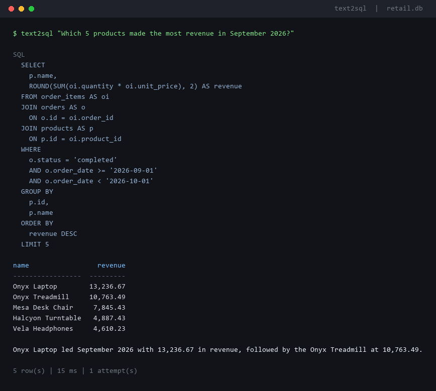

# text2sql-agent

Ask a business question in plain English. Get back **validated, read-only SQL**, a table, and a
one-line answer.



<sub>Recorded offline with a scripted model against the bundled demo data, so the image is
reproducible without an API key. The SQL, rows and timings are real output from the pipeline — only
the generation step is scripted. Add a key and the same command runs live.</sub>

## The interesting part is not the prompt

Getting a model to emit `SELECT ... GROUP BY ...` is a weekend project. The hard part is that
**the model's output is untrusted input pointed at a production database**. A prompt injection in a
column value, an over-eager `DELETE`, or a Cartesian join that pins a CPU for ten minutes are all
one bad generation away.

So the design assumption here is that the model is a *hostile* generator. Every query it produces
is parsed, checked, executed against a read-only connection, and time-boxed — before anyone sees a
result.

## Pipeline

```text
question
   │
   ▼
system prompt  =  live schema + data conventions + 5 worked examples
   │
   ▼
  LLM  ──────────────────────────────►  SQL
                                         │
                    ┌────────────────────┴────────────────────┐
                    │  1. exactly one statement               │
                    │  2. must be SELECT / UNION              │
                    │  3. tables must be on the allowlist     │
                    │  4. no load_extension / readfile / ...  │
                    │  5. row cap injected as LIMIT           │
                    └────────────────────┬────────────────────┘
                                         ▼
                    read-only SQLite connection (mode=ro, query_only, 5 s timeout)
                                         │
              error ──► fed back to the model, up to 2 corrections
                                         │
                                         ▼
                          summary call ──► answer + table
```

| Stage | File |
| --- | --- |
| Schema grounding | `src/text2sql/schema.py` |
| Prompting, few-shot, retry loop | `src/text2sql/agent.py` |
| SQL validation | `src/text2sql/guard.py` |
| Read-only execution | `src/text2sql/executor.py` |
| Model transport | `src/text2sql/llm.py` |
| CLI | `src/text2sql/cli.py` |

## Safety, in layers

The guard is Python code, but it is not the only thing standing between a bad generation and your
data:

| Layer | Stops |
| --- | --- |
| Parser check (sqlglot) | Writes, DDL, `PRAGMA`, `ATTACH`, multi-statement injections |
| Table allowlist | Queries against `sqlite_master` or any table outside the schema |
| Function denylist | `load_extension()`, `readfile()`, `writefile()` — the usual SQLite escapes |
| Row cap | `SELECT *` streaming a million rows into memory |
| `mode=ro` URI | Any write that somehow gets past the parser |
| `PRAGMA query_only` | Writes even if the file permissions allowed them |
| Progress-handler timeout | Queries that never finish |

The guard's rejection messages are written as *corrections*, not exceptions — they are fed straight
back to the model, which is why the retry loop converges instead of flailing:

```text
That query failed: Unknown table(s): sales. Use only these tables: categories, customers,
order_items, orders, products, returns.
```

That message is an assertion in the test suite, not decoration.

## Grounding

The model never receives a dump. It gets table names, columns, types, foreign keys, row counts and
two sample rows — enough to write correct SQL without spending the context window on 13,000 rows:

```text
TABLE orders (5,200 rows)
  id INTEGER  [pk]
  customer_id INTEGER  [not null, fk -> customers.id]
  order_date TEXT  [not null]
  status TEXT  [not null]
  channel TEXT  [not null]
  e.g. (1, 287, '2025-02-14', 'completed', 'web')
```

Data conventions that are invisible in the schema — "revenue means completed orders only, quantity
times unit price" — are stated explicitly. Without them, two correct-looking queries return two
different numbers and nobody can say which is right.

## When the question is ambiguous, it asks

"Revenue" gross or net of returns? "Last month" as a calendar month or the trailing 30 days? The
model is instructed to answer `CLARIFY: <question>` instead of picking one silently:

```text
$ text2sql "top products by revenue"

Clarification needed: Should revenue be gross or net of returns?
```

Guessing here is how a dashboard quietly reports the wrong number for a quarter.

## Evaluation

`eval/questions.yaml` holds 40 questions — 14 basic, 16 intermediate, 10 advanced — each with
reference SQL that defines the correct answer:

- the expected result is computed by running the reference SQL, so it cannot drift from the fixture;
- both sides go through the same guard and row cap;
- rows are compared as a multiset by default, or as an ordered list for ranking questions;
- floats are rounded and `1234` equals `1234.0`.

```bash
python eval/run_eval.py            # needs an API key; prints accuracy and per-question failures
python eval/run_eval.py --fake     # no key: replays the reference SQL to verify the harness itself
python eval/run_eval.py --verbose  # show expected vs actual rows for failures
```

`--fake` scores 40/40 by construction — it proves the harness runs end to end, not that a model is
good. The real number depends on the model, so the repo does not ship one. Run it with your key and
the report lands in `eval/report.json`:

| model | score | notes |
| --- | --- | --- |
| `--fake` | 40/40 | harness check, not model quality |
| your model | run it | `python eval/run_eval.py --model gpt-4o-mini` |

The comparison is deliberately strict: a query that drops `ORDER BY` on a ranking question fails
even if it returns the right rows in a lucky order. `tests/test_eval.py` asserts exactly that.

## Quickstart

```bash
python -m venv .venv
.venv\Scripts\activate          # Windows
# source .venv/bin/activate     # macOS / Linux

pip install -e ".[dev]"
cp .env.example .env            # then put a key in it
```

```bash
python -m text2sql "How many orders were cancelled?"
python -m text2sql                          # interactive
python -m text2sql --show-schema            # exactly what the model sees
python -m text2sql "top 5 customers by spend" --json
```

Any OpenAI-compatible endpoint works — OpenAI, Groq, OpenRouter, Together, vLLM, LM Studio:

```dotenv
T2SQL_API_KEY=sk-...
T2SQL_BASE_URL=https://api.openai.com/v1   # optional
T2SQL_MODEL=gpt-4o-mini                    # optional
```

The demo database is generated on first run and is byte-for-byte reproducible (`seed.py`, fixed
seed, fixed as-of date), which is what makes the eval numbers stable.

```bash
pytest                       # 101 tests
python eval/run_eval.py --fake
```

## Layout

```text
src/text2sql/
  agent.py      prompt, few-shot examples, generate/validate/execute/retry loop, summary
  guard.py      parse and validate generated SQL
  executor.py   read-only, time-boxed query execution
  schema.py     schema introspection and prompt rendering
  llm.py        OpenAI-compatible transport
  cli.py        command line
  seed.py       deterministic demo data
  testing.py    scripted model for tests and offline demos
eval/
  questions.yaml   40 questions + reference SQL
  run_eval.py      accuracy harness
tests/             101 tests
docs/demo.png      the screenshot above
```

## Design notes

**Why not just let the model run the query?** Because "read-only" in a prompt is a suggestion. It
becomes a guarantee only when the database enforces it.

**Why a second model call for the answer?** The rows are already correct; the only thing left is
prose. The summary is capped at two sentences and told to use only values in the rows, and if it
fails the rows are still returned with a deterministic fallback — a broken summary must never cost
you the data.

**Why is the demo data synthetic and deterministic?** A public repo whose accuracy number changes
every run is not evidence of anything. Deterministic data means a failing question is reproducible.

**Why SQLite?** Zero setup for a reviewer, and `mode=ro` gives real filesystem-level read-only
enforcement. The guard and executor are dialect-agnostic; swapping in Postgres is a connection
change plus a different parser dialect.

## Limitations

- Single-turn: it does not ask follow-ups after a clarification, you restate the question.
- No joins beyond what the model composes; there is no query planner or view layer.
- SQLite only, and the eval covers a 6-table schema. Wider schemas need schema retrieval rather
  than a full dump in the prompt.
- `SUM(unit_price)` style mistakes are only caught when a reference question happens to cover them.

## Next

- A schema-retrieval step so large warehouses can be supported.
- Golden-query caching: if a question matches a verified query, skip generation entirely.
- Confidence signal from the model, used to route low-confidence answers to a human.
- Postgres mode with row-level security, plus query-cost estimation before execution.
